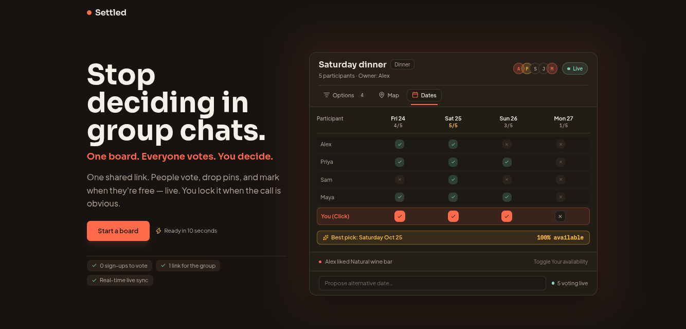

# Settled — Client

Frontend for **Settled**, a shared decision board for groups. Propose options, vote live, poll availability, drop map pins — until an owner locks in the final decision.



## Tech

React 19 · Vite · Redux Toolkit · Tailwind CSS · Socket.io · MapLibre

## Features

- Create a board, share an invite link — no signup for participants
- Real-time voting, comments, and availability for everyone on the board
- Date availability grid with live aggregates
- Shared interactive map with place search and opt-in personal pins
- Owner-only settings and decision lock-in

## Getting Started

```bash
npm install
cp .env.example .env   # points at the local backend on :5000
npm run dev            # http://localhost:3000
```

In production the client talks to the backend through the same origin (`/api`), so only `VITE_SOCKET_URL` is needed for live updates.

## Scripts

| Command         | Purpose              |
| --------------- | -------------------- |
| `npm run dev`   | Dev server with HMR  |
| `npm run build` | Production build     |
| `npm run lint`  | ESLint               |
| `npm run preview` | Preview the build  |

## Structure

```
src/
├── pages/        Routes (Landing, Create, Board, Join, Share, Recover)
├── features/     Feature UI — board, options, voting, threads,
│                 availability, map, landing
├── components/   Shared UI (menus, form fields, lightbox)
├── store/        Redux slices — board + session
├── services/     API clients (axios) and the socket connection
├── hooks/        Board socket, form errors, small utilities
└── utils/        Pure helpers (dates, geolocation, validation)
```
